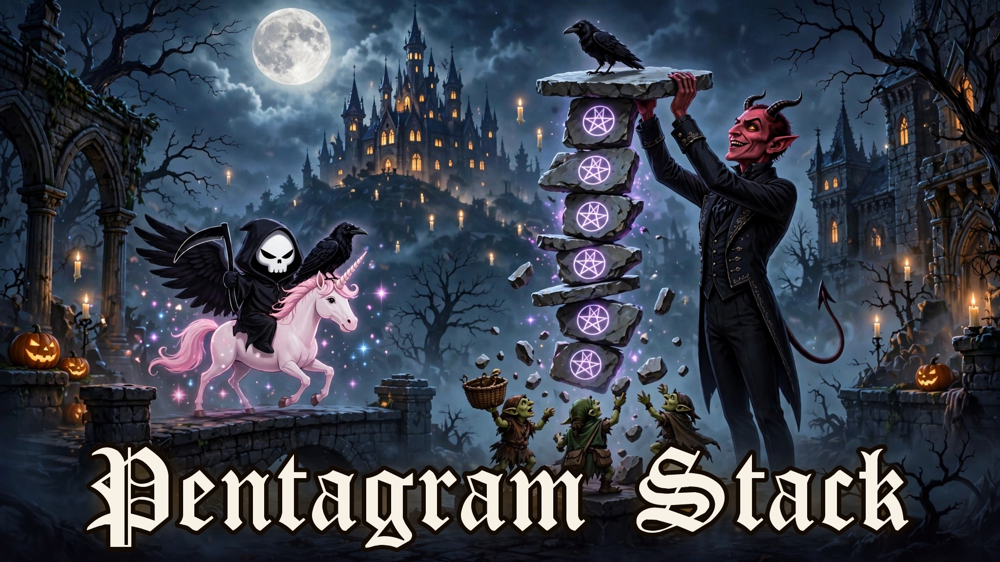
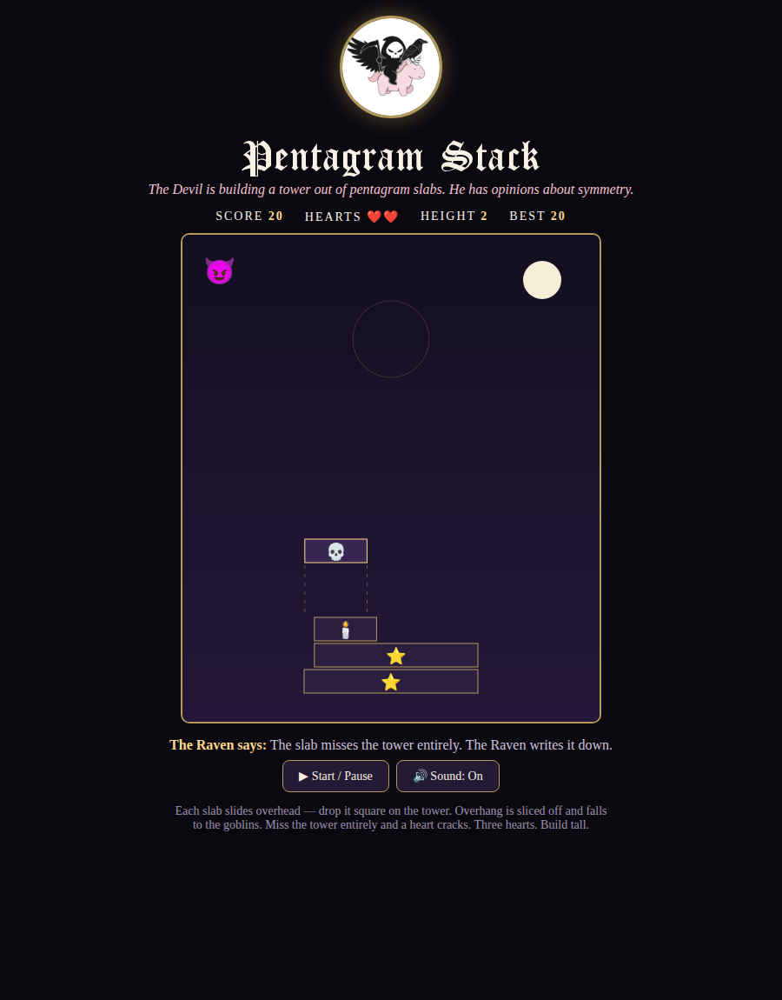

# 😈 Pentagram Stack



**Built with: TypeScript** (`src/game.ts` — compiled build in `game.js`)

**The Devil is building a tower out of pentagram slabs. He has opinions about symmetry.**

A stacking game from the gothic world of **Grin Reaper**. Each slab slides in overhead — drop it square on the tower. Overhang gets sliced off and rains down on the goblins. Miss the tower entirely and a heart cracks. Three hearts. Build tall, build smug.

## ▶ Play it live

**[Play Pentagram Stack](https://itsgrinreaper.github.io/pentagram-stack/)** — free, in your browser.

## 📸 Preview



## How to play

- **Drop the slab:** click, tap, or Space
- Perfect drops pay **+25**; wobbly trimmed ones pay **+10** and the Devil's contempt
- Miss the tower and lose a heart — you have **3**
- The slabs speed up as the tower climbs. So does his commentary.

## Build it yourself

```bash
npx -p typescript tsc -p tsconfig.json
```

*The Raven supervises. The goblins catch the trimmings. The tower has no permit.*
